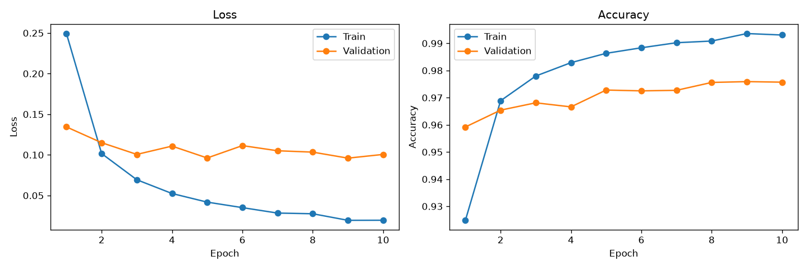

# MNIST ile MLP Tabanlı El Yazısı Rakam Tanıma

Kod ve tüm çıktılar: mnist_mlp.ipynb
Çalıştırma: pip install -r requirements.txt → notebook'u baştan sona çalıştır.

## Hiperparametreler
- Mimari: 784 → 256 → 128 → 10 (2 gizli katman, ReLU), 235146 parametre
- Kayıp fonksiyonu: CrossEntropyLoss
- Optimizer: Adam (learning rate = 0.001)
- Batch size: 64, Epoch: 10, Seed: 42
- Veri ayrımı: 50.000 train / 10.000 validation / 10.000 test (test kümesi yalnızca en sonda bir kez kullanıldı)
- Normalizasyon: mean = 0.1307, std = 0.3081

## Deney 1 Sonuçları
| Metrik | Değer |
|---|---|
| Training loss | 0.0195 |
| Validation loss | 0.1005 |
| Training accuracy | 0.9931 |
| Validation accuracy | 0.9757 |
| Test accuracy | 0.9789 |
| Eğitim süresi | 102.0 sn (CPU) |

## Kendi El Yazısıyla Test
Öğrenci numarası: 24120205039
Orijinal görüntü: ogrenci_no/ogrenci_no.jpg
İşlenmiş 28×28 rakamlar: ogrenci_no/islenmis/
Tahmin sonuçları ve doğru rakam sayısı: notebook'taki son hücrenin çıktısı ve aşağıdaki görsel.

Ön işleme adımları: gri tonlama, arka plan düzeltme, renk ters çevirme (siyah zemin / beyaz rakam), rakamların ayrılması, çizgi kalınlaştırma, 20×20'ye ölçekleme, kütle merkezine göre 28×28'e ortalama, MNIST ile aynı normalizasyon.

## Genel Değerlendirme
Model MNIST test kümesinde %97.89 doğruluğa ulaştı. Train loss 0.0195'e kadar düşerken validation loss 3. epoch'tan sonra yaklaşık 0.10 civarında sabit kaldı; bu durum modelin hafif aşırı öğrenmeye (overfitting) başladığını gösteriyor ve dropout veya erken durdurma ile iyileştirilebilir. Kendi el yazımla yazdığım numaradaki sonuçlar, eğitim verisi ile gerçek dünya verisi arasındaki farkı (distribution shift) gözlemlemeyi sağlıyor: kalem kalınlığı, yazım stili, tarama koşulları ve ön işleme MNIST görüntülerinden farklıdır. Ayrıca MLP görüntüyü düz bir piksel vektörü olarak gördüğü için rakamın konumundaki, eğimindeki ve kalınlığındaki küçük farklara CNN'e göre daha hassastır.